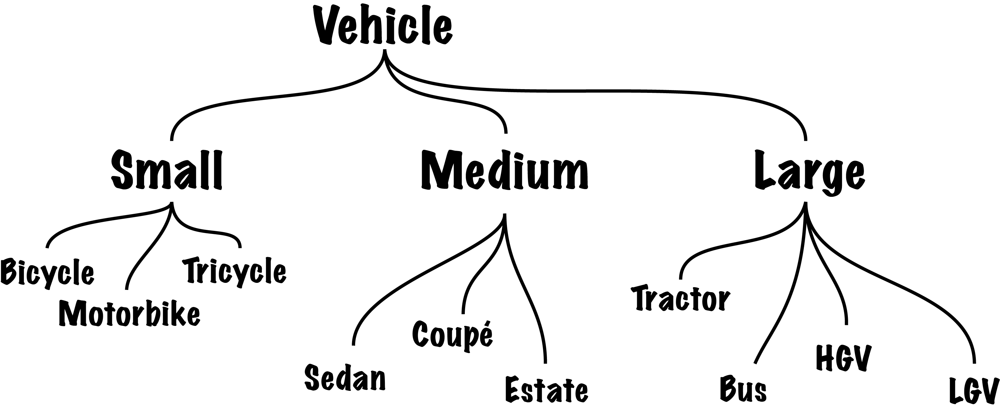
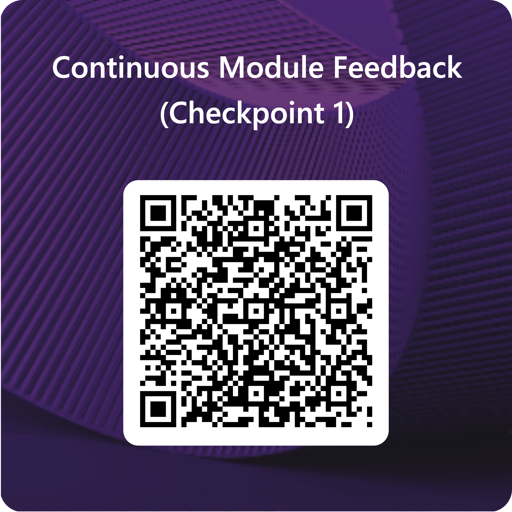

<h2>Last Week, You Said...</h2>

> ...

> ...

> ...

::: {.notes}


:::

## Why these three?


::: {.notes}


:::

## This Week's Question

<blockquote style="margin-top:150px">Who decides what counts as an error?</blockquote>

&nbsp;

We'll answer it with code and readings.

. . .

> "Data do not need cleaning until there are strangers in the dataset." ~ @dignazio:2020ch5 [p.133]

::: {.notes}

Three levels, one question. In Python the programmer decides which problems are expected (trapped) and which are not. In data, the analyst decides what is an outlier or a mistake. In teaching, the teacher decides which mistakes are useful.

:::

# Predict the Output

Pairs. No laptops. Vote with your fingers.

::: {.notes}

Pairs means *whoever is sitting next to you*. Hour 1 is tight, so keep each snippet to about 3 minutes. 30 seconds to agree, then fingers up together. Reveal, then ≤ 60 seconds on the story. Tell video stories as "In the video, Jon...".

:::

## 1. The Pizza That Changed {.smaller}

```python
# the pizza class from the video, unchanged
p1 = pizza(sauce='white')
p1.add_topping('peppers')

p2 = pizza()
p2.base = "Plain old base"

pizza.base = 'Crusty'

p3 = pizza()
```

How many of `p1`, `p2` and `p3` now have a `'Crusty'` base?

1. 0
2. 1
3. 2
4. 3

. . .

**Answer: 3 (two of the three): `p1` and `p3`.** `p2` set its own base, so the class change doesn't reach it.

::: {.notes}

From Classes ("Pizza in Action"). The answer is option 3 (two pizzas). Option 4 (all three) is the expected wrong answer: count the hands.

Story: a class variable is a rule written on the recipe, and every pizza that hasn't set its own follows it, even ones already out for delivery.

:::

## 2. Where's the Bug? {.smaller}

```python
total = 0
print("About to start loop"
for i in range(1,10):
  total += i
print(total)
```

Which line is actually wrong?

1. Line 1: `total = 0`
2. Line 2: `print("About to start loop"`
3. Line 3: `for i in range(1,10):`
4. Line 5: `print(total)`

. . .

**Answer: 2.** The missing `)` is on the line *before* the one Python complains about, in older versions.

::: {.notes}

From Errors ("Challenge 1"). Skip this one if you are behind at minute 9. In the video, Python points at the colon on line 3. Newer Python (3.10 and later) says `'(' was never closed` and points at line 2, so the message has got better since the video was recorded. The lesson is the same: the line Python blames isn't always the line that's wrong.

Story: the unclosed bracket three lines up. Python decided the error was where it gave up, not where it started.

:::

## 3. Trapped {.smaller}

```python
x,y = 10,0
try:
  print(x/y)
except ZeroDivisionError:
  print("You can't divide by zero!")
except:
  print("Something has gone very wrong.")
finally:
  print("Division is fun!")
```

What does this print?

1. `You can't divide by zero!` then `Division is fun!`
2. `Something has gone very wrong.` then `Division is fun!`
3. A `ZeroDivisionError` traceback
4. Only `You can't divide by zero!`

. . .

**Answer: 1.** The named `except` catches it, the generic one is skipped, and `finally` always runs.

::: {.notes}

From Errors ("Trapping Errors"). In the video, Jon's image is that named `except`s are like `elif`, the bare `except:` is like `else`. Option 4 is the expected wrong answer (people forget `finally`).

:::

## 4. Raising Hell {.smaller}

```python
x,y = 10,0
try:
  print(x/y)
except ZeroDivisionError:
  print("You can't divide by zero!")
  raise Exception("Please don't do that again!")
finally:
  print("Division is fun!")
```

1. Two messages, then the program ends normally
2. Two messages, then a traceback that ends `Exception: Please don't do that again!`
3. Only a traceback
4. `Division is fun!` is never printed

. . .

**Answer: 2.** `finally` still runs, and the traceback shows *both* errors ("During handling of the above exception, another exception occurred").

::: {.notes}

From Errors ("Raising Hell" and "Understanding Multiple Errors"). The first error is the clue to the real problem; the second tells you what was happening when it was triggered. Don't tell the room the answer to 4 first: ask which messages they expect on screen.

Say: whoever wrote the `raise` decided that this was an error worth stopping for. That's the week's question in four lines.

:::

# Who Decides What Counts as an Error?

## Vote

According to the reading you did, the person who decides is...

&nbsp;

1. **The analyst:** that's what expertise is for. Decide, and document it.
2. **The rules:** decide in advance, in code, so anyone can check.
3. **The people the data describe:** everyone else is a stranger in the dataset.

::: {.notes}

First, hands: who read D'Ignazio & Klein? Etherington? Both? Neither?

Then fingers, **by reading**: D'Ignazio & Klein readers first, then Etherington.

Then **1 minute of silent writing** ("my vote, and one passage"), *then* 4 minutes with neighbours: compare votes and find *one passage* that proves yours. Anyone who didn't read is briefed by a neighbour.

Plenary (about 8 min): walk the room and **ask pairs, not individuals** ("What did you two decide?"). Ask which reading only *after* they've answered. Start with D'Ignazio & Klein, because it's the one that has an answer. End on Etherington: who decided which mistakes the students are allowed to make?

:::

## D'Ignazio & Klein (2020)

> But what might be lost in the process of dominating and disciplining data? Whose perspectives might be lost in that process? And, conversely, whose perspectives might be additionally imposed? ~ @dignazio:2020ch5 [p.131]

::: {.notes}

Reading notes:

- Cleaning isn't a neutral process. It's a removing of observations from a data set, and potentially therefore a removal of people.
- The Wickham critique is fair but a little unsubtle: "tidy data" is as much about reproducibility, wide vs long data and linking operations. The decisions we make when cleaning aren't always bad. It's more about how much we understand our data. (TfL data is an example: you can't just 'ask someone' for the Oyster card data because what is logged depends on what purpose the data was collected for in the first place.)
- The map the chapter opens with (the AEMP "Narratives" map, pp.127--129) breaks the rules of good data visualisation on purpose. If you're going to do that, be explicit about why.

:::

. . .

> Likewise, data do not need cleaning until there are strangers in the dataset. ~ @dignazio:2020ch5 [p.133]

::: {.notes}

Reading notes: the Clemson example, where "upstate" was perfectly clear to Clemson's librarians but useless to anyone else. The analogy is street names: you don't need them until there are strangers in the landscape. Understanding the process by which data was generated matters ("data settings").

The argument runs like this:

- Streets: people who live somewhere know their way around by local knowledge ("the road past the post office"). Street names and house numbers only become necessary once outsiders arrive and need a standard system. The authors' wording comes from the chapter's discussion of how this standardisation happened, and your margin note on that page ties it to "the systematisation required for street names in the previous century".
- Data: their example is the Clemson University Library dataset, which uses "upstate" for a region of South Carolina. To Clemson's own librarians that was perfectly clear. Once "hackers in Cambridge" tried to map every library record in the US, "upstate" stopped being usable. The data then "needed cleaning", meaning standardising to a form outsiders can read.
- Their point: "dirty" data often just means data that was clear to the people who made it and opaque to everyone else. The cleaning is done for the stranger's benefit, and it can overwrite the local meaning. The risk they name is epistemic violence, where the stranger's way of knowing wins (p.133).

:::

. . .

> Does one choose cleaner data at a larger scale that is relatively easy and quick to purchase? Or more accurate data at a local scale for which one has to engage and build trust with community groups? ~ @dignazio:2020ch5 [p.135]

::: {.notes}

Reading notes: this is a real-world question for research or for money. The authors clearly feel there is a right answer, but I think if we asked them directly they'd acknowledge the complexity: the Eviction Lab turned to a real estate data broker to try to produce a country-wide picture of evictions; but the AEMP said it found **three times** the number of evictions in the areas that it was monitoring closely!

:::

## Etherington (2016)

> The concepts of location, event, neighbourhood, field, object and network (Figure 1a) are a succinct list of spatial concepts used as the basis for six laboratory exercises [...] ~ @Etherington:2016 [p.118]

::: {.notes}

Reading notes: can you map these onto modules and taught content? Why do we ask you to read about this approach and not follow it? (1) It shows how teachers connect concepts and applications, in a way students can't always see. (2) It shows how many programming concepts transfer across contexts. (3) It helps you connect your first five weeks to the places they could be applied. Also: notice how things are connected up here. That's the reflective part.

The six concepts are a set of categories chosen by a teacher, so they're a decision about what counts. The same question as the Tree of Vehicles, coming next.

:::

. . .

> Unwin (1980) argued for open-ended laboratories, as highly structured laboratories do not teach research skills and result in students producing nearly identical work. ~ @Etherington:2016 [p.123]

::: {.notes}

Reading notes: these debates aren't new. We're a little more structured than Unwin would like, but we also try to say what should be coming along. Etherington's other ideas for open-ended laboratories are on the same page and are coming up in the bridge.

:::

# What Counts?

## Where Do E-Bikes, Unicycles and Rickshaws Go?

{fig-alt="Class hierarchy diagram grouping types of vehicle"}

. . .

Someone chose these categories. Who? And for what?

::: {.notes}

1 minute of silent writing: "Where would *you* put a rickshaw, and why?" Then 2 minutes with neighbours. Ask two pairs, not individuals.

The note from the slide: an automobile manufacturer and a government trying to implement a tax policy would make *different* choices. Same for Etherington's six concepts: another teacher might pick other ones. A class hierarchy is a decision about what counts as a thing and what counts as a special case.

:::

## What Happens to What Doesn't Fit?

```python
try:
  #... some code that might fail...
except <Named_Error_Type>:
  #... what do it if it fails for a specific reason...
except:
  #... what to do if it fails for any other reason...
finally:
  #... always do this, even if it fails...
```

. . .

> But what might be lost in the process of dominating and disciplining data? ~ @dignazio:2020ch5 [p.131]

::: {.notes}

In the video, Jon asks what you should do with input that doesn't fit: ignore it, try anyway, or tell the user? A bare `except:` that does nothing is the code version of dropping the outlier: the program carries on and nobody knows what was lost.

1 minute of silent writing: "What would `except: pass` do to an Airbnb listing with a price of 0?" Then 2 minutes with neighbours. Ask two pairs.

The video's manifesto says it from the programmer's side: ignoring a bug or "just squashing it without understanding it is storing up trouble for the future".

:::

## Deliberate Mistakes

> [...] including deliberate mistakes that need to be corrected [...] ~ @Etherington:2016 [p.123]

. . .

**Listen for:** in today's practical, where does Python throw an error on purpose?

::: {.notes}

Etherington lists this as one way to make a laboratory more open-ended. The practical does it in the classes section: you get an error until you implement the missing method, and the error tells you what's missing. Here an error is information from the person who wrote the code to the person using it.

Hand-off to the admin and practical intro. Skip this slide if you are behind at minute 33.

:::

## A Word About Groups

Groups must be confirmed by the **end of this week**.

- The [sign-up form]() is open until **Monday 2 November**.
- Anyone not in a group will be matched to a group with space.
- Why groups, and how they work: [Group Working](./3.6-Group_Working.qmd).

::: {.notes}

Keep this short. Jon is in the room from minute 40: send questions about assessment or groups to him.

:::

## Intro to the practical

Here's what we're covering:

- Trying to pull together everything you've learned over the preceding few weeks: functions, decorators, DoLs, list comprehensions, etc.
- We're going to work through creating several functions as well as a decorator to handle downloading and caching data from a remote URL in a way that saves on bandwidth costs by checking a local cache to see if a file exists before mindlessly requesting another copy from the URL.
- We're going to look at how writing comments — and they can be quite verbose when you're starting out! — can help you to understand what's going on.
- And we're going to place these functions into a library file so that they can be imported.

## Optional second half

There is a **second section** that is about making use of classes and inheritance. This will help you a *lot* when you get to understanding how Pandas and Geopandas work and it's the *core* power of Python, but do not panic if you run out of time to get to this. You will also pick it up through *using* Python. That's not an excuse to not engage with the ideas, it's an excuse for not spending nine hours on this practical. 

You will see:
  - Custom exceptions
  - Abstract base classes
  - Inheritance
  - Class and instance variables
  - A tiny bit of polymorphism.

::: {.notes}

Then Jon presents the assessments deck (`5.5-Assessments`, minute 40 to 60), then the break (7 min). After the break: Ollie's talk, which starts at minute 67 and stops at 114.

:::

# Over to Ollie Ballinger

## Listen For...

> [CHECK: one reading quote that frames the guest's topic]

Listen for: [CHECK: one question about the talk, tied to "Who decides what counts as an error?"]

::: {.notes}

Say Ollie's name and topic as given ([CHECK: topic]). Don't say more about the talk than that. Hard stop at minute 114 (a timer on the lectern): the exit ticket follows.

:::

# Over to You

## Continuous Feedback

[Continuous Module Feedback (Checkpoint 1) – Fill out form](https://forms.cloud.microsoft/e/XkbiGdb67V)



## Before You Go...

Complete the sentence:

&nbsp;

A data point should be treated as an error (and removed) **when / never**..., because...

&nbsp;

A selection will open next week's session.

## Input

Provide your input here: [form.menti.com/s/alujv3evg5eh](https://form.menti.com/s/alujv3evg5eh)

{height="500px"}

::: {.notes}

Mentimeter (open text) in a second browser tab. Start at minute 114 sharp, leave the code on screen, and give 3 minutes of silence before saying anything else. Say that it's anonymous, and that today opened with three of last week's. Jon runs the Mentimeter, so he is back in the room by minute 114.

:::

# Thank You {background-image="/img/web/title-slide.png" background-color="#f7eff5" background-opacity="0.2"}

<h3>References</h3>
