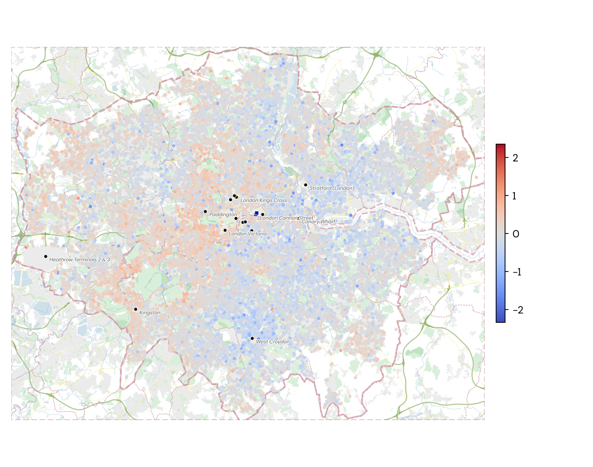
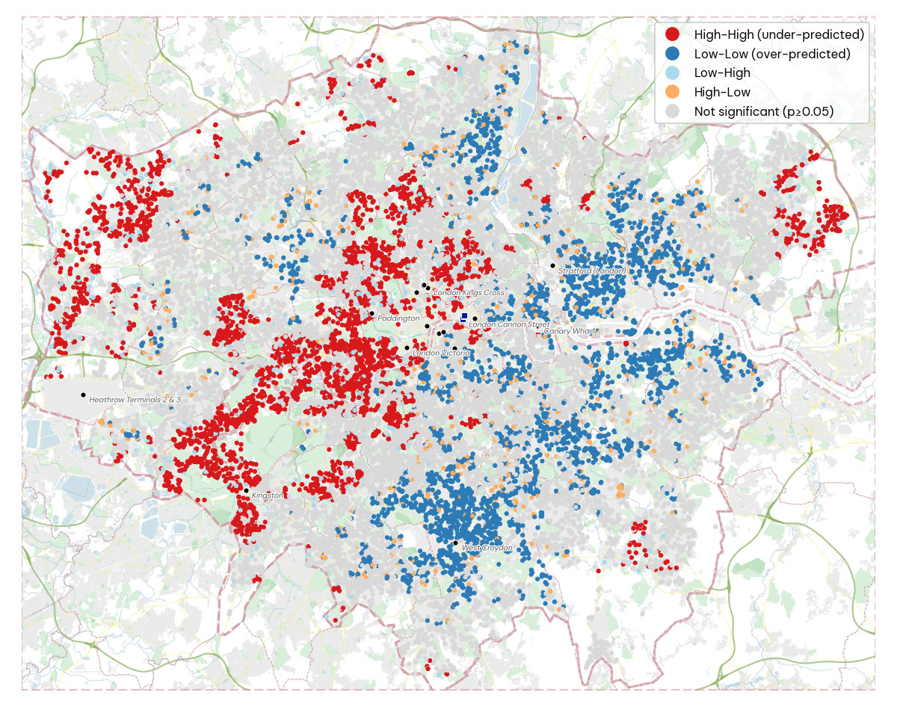
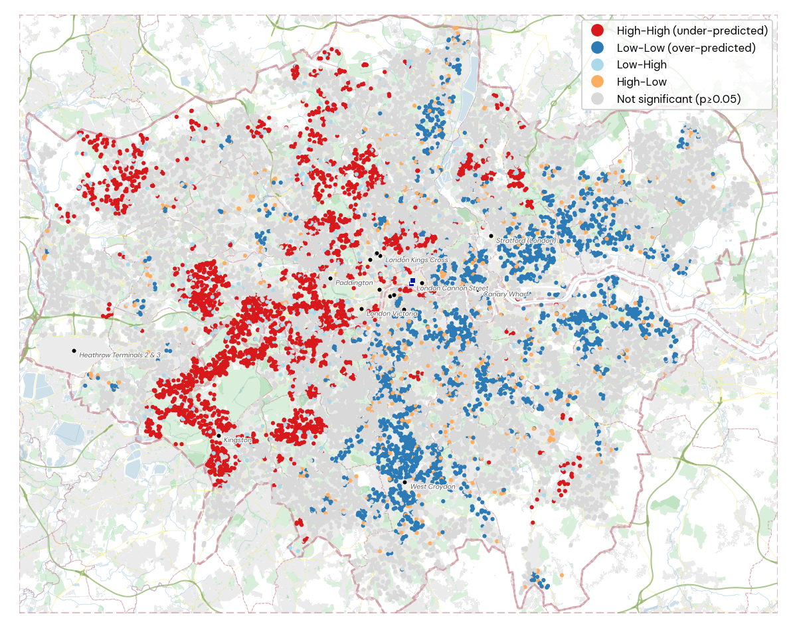
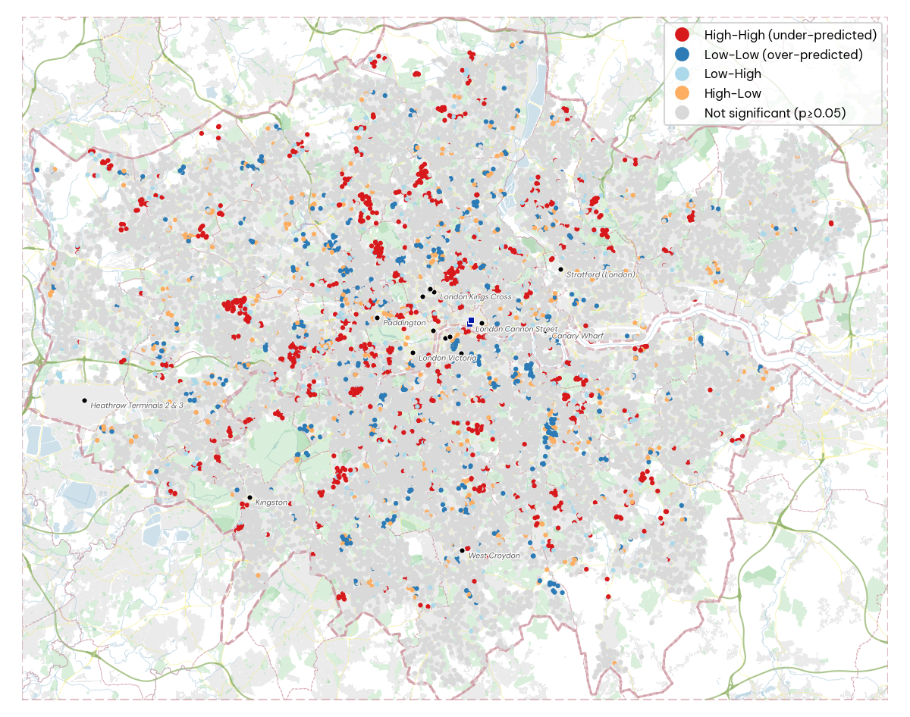
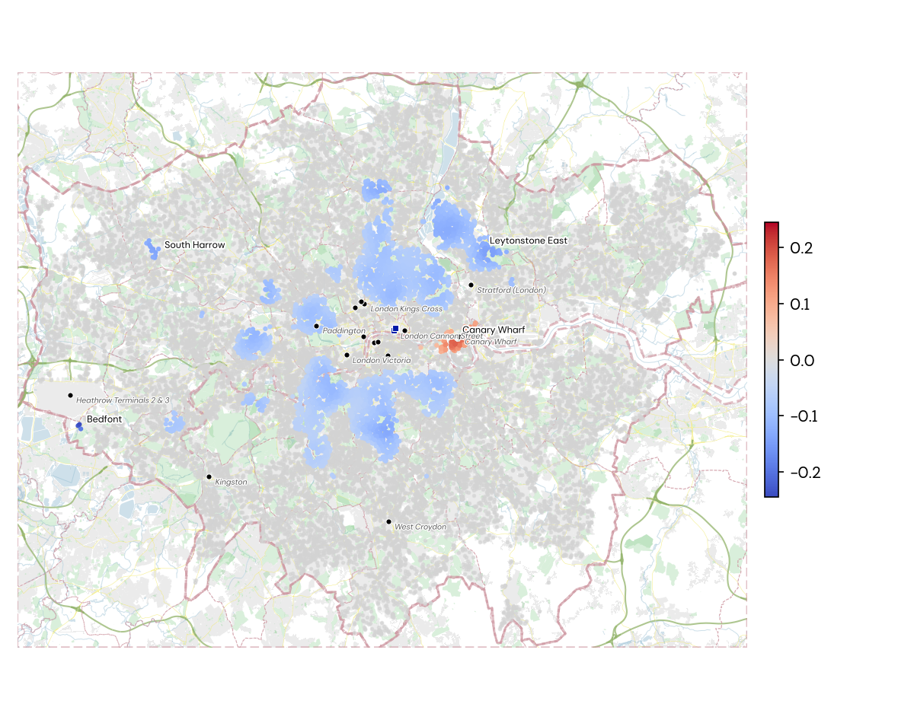

## This Week's Question

<blockquote style="margin-top:150px">Is 'no data' the same as nothing?</blockquote>

&nbsp;

We'll answer it with code, two readings and two cases.

. . .

> "The absence of data becomes an important takeaway, as meaningful as the data themselves." ~ @dignazio:2020ch4 [p.113]

::: {.notes}

Run sheet, for the room: two snippets, then each reading followed by a case that uses it. The exit ticket is *before* the group check-in today, so it actually happens.

:::

## Recall: A Way to Read Any Analysis[^1]

<div style="margin-top:80px; font-size:1.3em; text-align:center">
**Inputs** → **Cleaning** → **Method** → **Analyst** → **Consumer**
</div>

&nbsp;

<div style="text-align:center">
... and the **limitations** that come from each step.
</div>

[^1]: With thanks to Ollie Ballinger, who set this up with you in week 5.

::: {.notes}

These are the "units of analysis" Ollie put on the board in week 5. The room added cleaning (split out from method) and limitations. Use the same frame all session: every answer from a pair goes into one box, and you say which box out loud.

Today's question for the frame: *where in the pipeline does a missing value come from?* It can enter at any step: nobody collected it (inputs), someone dropped it (cleaning), a rule turned it into `NaN` (method), nobody thought to ask (analyst), or nobody wanted to see it (consumer).

:::

# Code Check

Pairs. Vote with your fingers. Then we run it.

::: {.notes}

30 seconds to agree, fingers up together, then **run the code live** (Jupyter in the Podman image) rather than revealing an answer. The answers are in these notes only, so the deck can be published before class.

:::

## 1. Nothing Equals Nothing?

::: {.columns}
:::: {.column width="40%"}
```python
import numpy as np
print(""==None)
print(None==None)
print(np.nan==None)
print(np.nan==np.nan)
print(np.nan is np.nan)
print(np.isnan(np.nan))
```
::::

:::: {.column width="29%"}
```{python}
#| echo: False

```
::::
:::

How many of the six lines print `True`?

1. 1
2. 2
3. 3
4. 4

## 1. Nothing Equals Nothing?

::: {.columns}
:::: {.column width="40%"}
```python
import numpy as np
print(""==None)
print(None==None)
print(np.nan==None)
print(np.nan==np.nan)
print(np.nan is np.nan)
print(np.isnan(np.nan))
```
::::

:::: {.column width="29%"}
```{python}
#| echo: False
import numpy as np
print()
print(""==None)
print(None==None)
print(np.nan==None)
print(np.nan==np.nan)
print(np.nan is np.nan)
print(np.isnan(np.nan))
```
::::
:::

How many of the six lines print `True`?

1. 1
2. 2
3. **3** (`None==None`, `np.nan is np.nan`, `np.isnan(np.nan)`)
4. 4

::: {.notes}

**Answer: 3** (`None==None`, `np.nan is np.nan`, `np.isnan(np.nan)`). Checked in the module's Podman image. The expected wrong answers are 2 (people don't believe `np.nan is np.nan`) and 4 (people expect `np.nan==np.nan`). Count the hands.

Say: `NaN` isn't equal to itself, because "unknown" doesn't equal "unknown". The only safe question is `is`, or `np.isnan`. Same for your data: two empty cells aren't the same thing.

:::

## 2. What Doesn't Fit?

```python
import pandas as pd
rooms = pd.Series(['Entire home/apt','Private room','Hotel room','Shared room'])
allowed = ['Entire home/apt','Private room','Shared room']
rooms = pd.Categorical(rooms, categories=allowed)
print(pd.isna(rooms).sum())
```

What happens to `'Hotel room'`?

1. It's kept: categories only describe the data
2. It silently becomes `NaN`
3. It becomes `NaN`, and pandas warns you
4. An error

::: {.notes}

**Answer: 3** in pandas 3.0 (the Podman image): it prints `1`, with a `Pandas4Warning` that this "is deprecated and will raise in a future version". In the video (6.4, "Dealing with Types") the answer was 2: values that aren't in the category list silently become `NaN`.

Say: pandas itself has decided that silently turning a real value into "nothing" is a bug. Nobody decided to delete hotel rooms: the category list did. That's the D'Ignazio & Klein point in one line of code, and it goes in the **method** box.

`'Hotel room'` is a real `room_type` in the London file (111 listings in June 2026).

:::

# Reading 1: D'Ignazio & Klein

## What Gets Counted Counts

**Pairs, 3 minutes** (30 seconds alone first):

> Using the census or Facebook examples, explain how a classification system decides what can be counted, and what this means for the claim that, with enough data, the numbers speak for themselves.

*(Study guide, Week 6)*

. . .

> "Women in poor countries seem to be asked about 6 times a day what kind of contraception they use," [...] "But they are not asked about whether they have access to abortion." ~ Seager, quoted in @dignazio:2020ch4 [p.98]

::: {.notes}

First, hands (20 seconds): who read D'Ignazio & Klein? Cox & Slee? Both? Neither? Anyone who didn't read gets briefed by their neighbour.

Debrief (5 min): ask pairs, and put each answer in a box out loud. Who counts → **analyst**. What gets counted → **inputs**. Who the count is for (the paradox of exposure) → **consumer**. The Seager quote is the prop: the survey asks some questions many times and never asks others, so the gaps are decided at the **inputs** stage.

The chapter is about gender and classification. The point isn't to take a side. It's that how things are counted shapes how resources are allocated, and that categories that don't fit the population give you bad data. On p.100: "it's corporations like Facebook, and not individuals like Maria Munir, who have the power to control the terms of data collection."

If someone says "missing just means missing": the Land Registry looks like all the transactions in the UK, but it leaves out Scotland, sales that aren't at market rate and shared ownership. That's structurally missing, and it isn't the universe.

:::

# Case 1: Error Is a Political Decision

## An Entirely Reasonable Model

Predicting **price per m²** for 22,853 London sales in 2024 with nine predictors:

:::: {.columns}
::: {.column width="48%"}
1. Floor area
2. Energy efficiency
3. Construction year
4. Attachment (detached → mid-terrace)
5. Flat or house
:::
::: {.column width="4%"}
:::
::: {.column width="48%"}
6. New build
7. Distance from centre
8. Bus stops within 500m
9. Rail within 500m
:::
::::

::: {.notes}

In week 1 I put up a slide called "Error is a Political Decision" and moved on. This is the material behind it, from my own research (the Atlas of Small Homes, part of the ESRC *No Space Like Home* project). Everything here is open data: Land Registry Price Paid, EPC certificates and OpenStreetMap, linked by address. That's the same linkage you'll see challenged next week.

Nine predictors, and every one is something a surveyor would look at. This isn't a straw man: models like this sit behind mortgage decisions, property tax assessment in several countries and the estimate on every property portal. On the frame, this slide is the **inputs** box.

Say the policy framing: imagine replacing Stamp Duty with a tax on assessed property value. The model sets every household's bill.

:::

## Which Model Sets the Tax Bill?

<div style="margin-top:40px; font-size:1.4em">

| | |
|:---|---:|
| Model **A** | R² = 0.32 |
| Model **B** | R² = 0.46 |
| Model **C** | R² = 0.64 |

</div>

::: {.notes}

No vote: it's a rhetorical question, so keep it to a minute. Anyone who knows what R² is will say C.

Same data, same nine predictors. A is ordinary least squares (the regression from QM). B is gradient-boosted trees. C is the same trees with two extra columns I'll name shortly. All cross-validated, so these aren't in-sample numbers.

Say: C, obviously, and on every conventional measure that's the right answer. The interesting part isn't which one wins, it's what changes (and what doesn't) from A to C.

:::

## What the Error Means for One Household

With **Model A**, of 22,853 homes:

- **46%** are valued more than **20%** wrong
- **27%** more than **30%** wrong
- **10%** more than **50%** wrong

::: {.notes}

Nobody lives in an R², and nobody is taxed on one. A household receives one number. These are counts, not estimates: for each home take actual ÷ predicted, then count how many are out by more than each threshold. The median home is out by 18%. That's the **consumer** box.

This is a scale argument: the model looks acceptable at the scale it's reported at (the whole city) and unusable at the scale it's applied at (one home).

If asked: R² is not a percentage error. R² = 0.32 and "about 30% wrong" look alike by coincidence: R² is the share of the variation the model accounts for; the percentages are how wrong each valuation is.

:::

## The Error Has a Map

{height="550px"}

::: {.notes}

Red is where the model under-predicts, blue where it over-predicts. If the error were noise, this would look like static. It doesn't: you can see structure from the back of the room.

Residuals are the part of the model most people never look at. Moran's I on these residuals is 0.42 (p = 0.001): the error clusters in space. You'll meet Moran's I and LISA properly next week; for today, just read the colours.

:::

## Who Pays?

{height="550px"}

::: {.notes}

Work it through once. Residual = actual − predicted. **Red**: a neighbourhood where homes sold for more than the model said, so the model consistently **under-values** it. **Blue**: the model consistently **over-values** it.

Ask: who knows London? Where's the red? (West and south-west.) Where's the blue? (East and south-east.)

So the model under-values the expensive half of London and over-values the cheaper half. Put it into a property tax and you haven't made a technical error: you've made a **wealth transfer**, from east to west. Wealthy households are under-assessed and poorer households over-assessed, and none of it shows in the R², because **R² can't tell you who is paying**. That's what makes the error political.

:::

## "So Use a Better Model"

{height="550px"}

::: {.notes}

The obvious objection, taken seriously: same nine predictors, swap the regression for gradient-boosted trees, a flexible modern learner. R² improves by about 45%, and the gain is real.

But it's the same map. Moran's I falls only from 0.42 to 0.32, and 35% of locations are still in a significant cluster. Red in the west, blue in the east: **the same transfer, from the same people, to the same people.**

**Accuracy and fairness are not the same axis.** If you only measure the first, you'll never find out what the second is doing.

:::

## Model C: Two More Columns

Same trees. Same nine predictors. Plus...

. . .

**x** and **y**: the coordinates. R² 0.46 → 0.64.

. . .

{height="420px"}

::: {.notes}

Eastings and northings. Two numbers that aren't a housing characteristic; no surveyor would list them.

And the map goes away: Moran's I goes 0.42 → 0.32 → 0.05. What's left is scattered and local, with no wealth geography in it. West London is no longer systematically under-valued.

So C really is the better model. But would you accept a tax bill that's higher because your house is "too far east"? Making a home "more x" isn't a basis for assessment you could defend to the household paying it.

:::

## Where the Failure Was

<div style="margin-top:120px; font-size:1.5em; text-align:center">
Not in the algorithm.

In the **list of things we thought were relevant**.
</div>

::: {.notes}

The slide to keep if you cut all the others. On the frame, this is the **analyst** box.

Nobody did anything wrong. The nine predictors are what expertise recommends. A careful team, cross-validating properly, ships Model B, and moves money from east London to west London.

**Link to this week's question.** Geography wasn't dropped by the model: it was never on the list. Nobody decided to leave it out; space is the background the variables sit on, not a variable. So the most important column was the one nobody thought to collect. Is 'no data' the same as nothing? Here, the missing column decided who pays.

:::

## An Average of Opposites

<div style="margin-top:100px; font-size:1.4em; text-align:center">
Construction year: **β = −0.055**, p < 0.001
</div>

**Pairs, 1 minute:** why would a newer London home be worth *less* per m²?

. . .

{height="420px"}

::: {.notes}

The global coefficient (from the OLS in the published GWR run, t = −22.3) says: the newer the home, the lower the price per m². Take two answers from pairs: build quality, small new flats, period features, snobbery about new-builds. All reasonable. Then say: every one of them assumes the coefficient means the same thing everywhere. Let's check.

The map is a geographically weighted regression (GWR): the same regression, but its coefficients can vary from place to place. Blue is a significant negative local coefficient, red a significant positive one, grey not significant. Blue across inner and north-east London: there, newer really is worth less. Then the red blob: **Canary Wharf**. It was built new and has no Victorian terraces to compete with, so the new tower *is* the premium product. Same variable, opposite meaning, two miles apart. Locally the coefficient runs from about −0.40 to +0.41: the global −0.055 is **an average of opposites**, and it's significant to three decimal places. That's the **method** box.

In fairness to the global model: GWR reaches R² = 0.70, but that's in-sample, so the comparison flatters it. And it throws things away too: some locations can't be fitted reliably, and it gives up the single clean number. Every model discards something; the question is what, and who decided.

:::

## Space Is Not Place

<div style="margin-top:80px; font-size:1.4em; text-align:center">
The coordinates fixed the **bias**.

They explained **nothing**.
</div>

. . .

<div style="margin-top:60px; text-align:center">
For Question 1: what's on *your* list, and who pays if something's missing?
</div>

::: {.notes}

The **limitations** box. Coordinates are space: a position on a grid. What the model never had is place: what a location means (Canary Wharf as a 1990s financial district on a dock). Model C knows *where* but nothing about *what here is like*. No bigger model fixes that: it's a question you have to ask before you fit, because afterwards all you have is a number that looks fine.

The assessment link: your Inside Airbnb analysis has a list of columns too. Before you start, write down what's on it, what isn't, and who would be affected if your answer were used for policy. Next week we'll see the same EPC and Price Paid data being challenged in print.

:::

## Before You Start Analysing

- Most groups over-complicate the analysis and under-complicate the answer. It's about who answers the question, not who writes the most code. One chart can be enough.
- Work on the questions *together*, not one each: the questions follow on from one another, and one member's data frame name won't match another's.
- Use a notebook as your scratchpad. See [Assessments](./5.5-Assessments.qmd) for when to move to Quarto.

::: {.notes}

Drawn from last year's week 6 talk. Keep this to two minutes.

Say: you can start the data analysis this week, but start by reading about the policy questions and what has already been done with the Inside Airbnb data. Taking data at face value, or your list of columns for granted, is the quickest way to get in trouble, as the last case showed.

:::

## Intro to the practical

Here's what we're covering:

- Moving from working with concepts one at a time to seeing them together, 'in the wild', in pandas.
- Reading in the Inside Airbnb data for the first time, and looking at its numeric columns.
- Counting nulls, by column and by row.
- Selecting and aggregating the data, and using indexes.
- Pandas is 'just' a sophisticated extension of what you've already done: lists, dictionaries and functions are underneath it.

::: {.notes}

`[CHECK]` These bullets are drafted from the session page and the practical's headings (there's no `Week 6 Session.md`). Replace them with your own if you prefer.

Then the break (7 min). Put the exit-ticket slide up during the break so people can get the QR early.

:::

# Reading 2: Cox & Slee

## Who Cleaned the Data?

**Pairs, 3 minutes** (30 seconds alone first):

> According to Cox and Slee, how did the cleaning of the New York City listings reflect the company's power and privilege?

*(Study guide, Week 6)*

. . .

> The company then presented November 17 as a typical day in the company's operations and mis-represented the one-time purge as a historical trend. ~ @Cox:2016 [p.1]

::: {.notes}

Debrief (5 min), onto the frame: the purge is **cleaning**, done by the company before publication. Airbnb is both the **analyst** and the main **consumer** of its own data, and decides what everyone else sees.

Margin notes: data cleaning isn't a neutral act. This is data science used to hold a firm to account. Over a thousand New York listings vanished from the website just before the company took the snapshot it published. The missing rows were the finding.

:::

# Case 2: Who Made the Data You're About to Use?

## Two Producers, One Platform

> Airbnb did not release the data sets to external parties: instead it presented a summary on its web site and allowed individuals to inspect the data under supervision at an office in New York. ~ @Cox:2016 [p.4]

. . .

| | Airbnb | Inside Airbnb |
|---|---|---|
| **Analyst** | The company | An independent project (Murray Cox, the "Cox" in Cox & Slee) |
| **Inputs** | Its own records | Scrapes of the public website |
| **Consumer** | Policymakers, on Airbnb's terms | Anyone, including you |

::: {.notes}

This is the module's own version of Ollie's measurement vs memory: the same platform, two different analysts and consumers. The company says its data are shared "so that policymakers can make informed decisions about home sharing in their communities" (p.4). Is a decision informed when you can't see the data?

Then turn it round: Inside Airbnb is also a choice of inputs. A scrape only sees what's on the public website, on the day it ran. What can't a scrape see? (Pairs, 1 min.)

:::

## One Empty Cell

In the London file you'll use (June 2026, 96,651 listings):

- **33,967** listings (35%) have no `price`.
- **29,470** of those aren't available on any day in the next year.
- **12,580** have no `bedrooms`, and **11,484** of those are private rooms.

. . .

Nothing, zero, or a finding?

::: {.notes}

Checked against `practicals/data/raw/20260917-London-listings.csv.gz`. No listing has a price of $0.00; the missing prices are genuinely empty.

Pairs, 2 minutes, then two pairs. The missing price is mostly a listing that isn't taking bookings: that's a finding about the platform (inactive, or not wanting to be found), not "nothing". Dropping those rows with `dropna()` would quietly change what "the London Airbnb market" means in your analysis.

Link back to case 1: the missing `bedrooms` field again. In a private room, the answer may be obvious (one), or the host may never have been asked. Same missing field, same choice to make, and you'll have to write down what you decided, because it's the reader of your work who has to trust it.

:::

# Over to You

## Before You Go...

Complete the sentence:

&nbsp;

A missing value **is / isn't** 'nothing', because...

&nbsp;

A selection will open the next session.

## Input

Provide your input here: [form.menti.com/s/alo5y7fjn6ss](https://form.menti.com/s/alo5y7fjn6ss)

{height="500px"}

::: {.notes}

Mentimeter (open text) in a second browser tab. **Minute 82, before the group check-in**: in weeks 4 and 5 the ticket at the end never ran. Leave the code on screen and give 3 minutes of silence. Say that it's anonymous, and that a selection will open week 7.

`[CHECK]` that the QR code points to this link.

:::

# Your Groups

## Group Check-In

A randomly selected group, 5 minutes:

- What have you read so far?
- What lines of inquiry are you thinking about?

. . .

**Everyone else:** where does their project sit on the frame? Which inputs? Who is the consumer? Where might their 'nothing' be?

::: {.notes}

Promised in week 5: a random group is asked what they've read and what they're thinking of, not a polished draft. Be constructive.

After the group speaks: 30 seconds alone, then pairs place the project on the frame. Ask two pairs. Then your feedback (about 5 min). This is the pattern for weeks 7--9, when a random group presents its draft answer to Questions 1--3.

:::

## Checkpoint!

::: {style="font-size:larger;"}
[forms.cloud.microsoft/e/XkbiGdb67V](https://forms.cloud.microsoft/e/XkbiGdb67V)
:::

{height="500px"}

::: {.notes}

Only if the Checkpoint 1 results are in (it was shown in the week 5 assessments deck). This replaces the 12-minute `6.0-Feedback` block with one slide. If there are no results, skip it and use the time as buffer.

:::

# Thank You {background-image="/img/web/title-slide.png" background-color="#f7eff5" background-opacity="0.2"}

<h3>References</h3>
