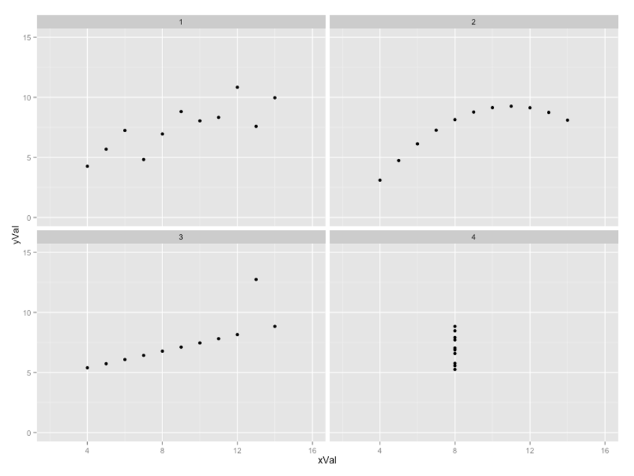
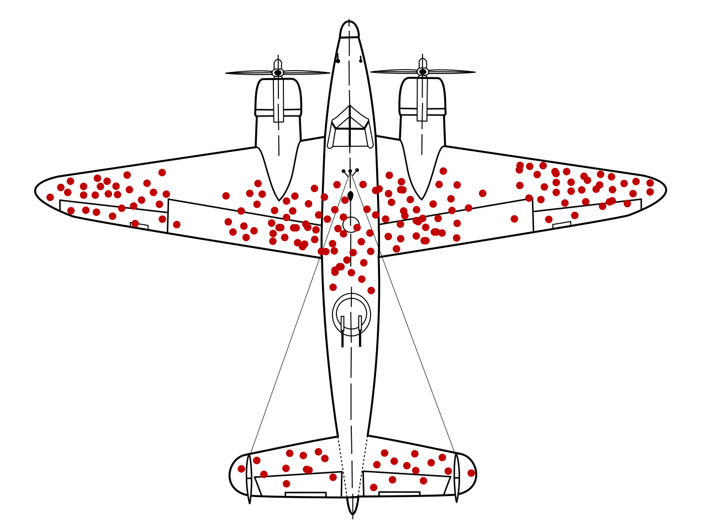

<h2>Last Week, You Said...</h2>

> "it represents an unknown value rather than zero"

> "Just because it's missing in the dataset, doesn't mean it's missing in the real world, in real, lived experiences!"

> "someone made a decision for it to exist or not to exist. politics behind that decision."

::: {.notes}

From the week 6 export (stem: "A missing value is / isn't 'nothing', because..."). The second quote is the second half of a longer answer that begins "A missing value always reflects a choice".

Reminder: these are anonymous, they get read, and three of them open each session. There's one at the end of today too.

:::

## Why these three?

- **Unknown, not zero:** the technical answer, and the right place to start. But *who* decides it's unknown?
- **Missing in the data, not in the world:** the data are the output of a process, which is today's question.
- **Someone made a decision:** today's readings are about who decides, and whether you can see it.

::: {.notes}

There were **four** responses last week, out of about 110 of you. All four were good. That's why the exit ticket matters (when I leave myself time to do them!): three of them open the next session, and four is barely a choice.

The three run from the technical answer to the political one. Let's explre whether that's the same thing.

:::

## This Week's Question

<blockquote style="margin-top:150px">Can you prove anything with numbers?</blockquote>

&nbsp;

We'll answer it with code, readings, and your draft answers to Question 1.

. . .

> "[...] we all want to be fair to our students". ~ @Bunday:0000 [p.3]

::: {.notes}

Three levels, one question. In code, the same data and a different line give a different answer. In the readings, one set of marks gives three different top students depending on how you total them. In your briefing, "is Airbnb out of control?" depends on what you decide to count.

Run sheet (again): a group's draft answer first, then the readings; after the break, predict the output, a real dispute about numbers, and where the numbers come from.

:::

# Group Slot

::: {.notes}
I realised that the best way to ensure I left enough time for the group questions was to *start* with them...
:::

## Draft Answers

- Your draft answer to **Question 1** is due this week; **Question 2** (professional landlords) is due next week.
- A group is selected at random to present its draft **now**. Formative feedback is given in class. If the group has not prepared an answer, there is no feedback.
- See [The Assessments](./5.5-Assessments.qmd) for how this works.

::: {.notes}

Keep this short.

:::

## Is Airbnb 'Out of Control' in London?

One group presents its draft answer. **Five minutes.**

When you listen, ask:

- What did they count, and what are they assuming?
- Where did the numbers come from? Who made them?
- What would change their answer?

::: {.notes}

Select the group at random. Use `/fsds-private/assessments/Group_Answer_Selection.py` so it's not a person. If the group has no draft, say so and move on: there is no feedback, as the assessments page says.

Plan:
- 5 minutes for the group (may need to prompt) 
- 1 minute of silent writing for the room
- 2 minutes with neighbours, 
- 6 minutes: ask **pairs** for feedback. 
- 6 minutes: give your own on the next slide: choose one thing they counted and ask what they'd need to know to believe it.

If the group runs over, stop at 5 minutes. Remind the room that the question is a draft: the point is the thinking.

Starting points for feedback if the group needs one: a published heuristic is better than a guess (estimate nights from reviews with a review rate and an average stay, then compare with the 90-day limit); read Airbnb's own methodology; think about density *relative to* something (homes, population) rather than raw counts.

:::

## What Would 'Out of Control' Mean?

You're asked: **Is Airbnb 'out of control' in London?** 

::: {.content-visible when-meta="answers"}

| You could count | You'd be assuming |
|---|---|
| Listings | every listing is a home taken off the market |
| Listings per 1,000 homes | the number of homes is the right baseline |
| Nights booked | that reviews are a proxy for bookings |
| Hosts with many listings | that they are "professional" |

. . .

Which one goes on slide 1 of your briefing? **Who decides?**

:::

::: {.notes}

**Clock: 20:00.** Provide feedback on the group's draft using this table. Point to the row that matches what the group counted and say what it assumes. Then ask the room the last line. Pairs only, and only if on time: if it's past 24:00, ask the question and leave it with them for their own drafts.

Don't give an answer: each choice is a transformation in Bunday's sense, which is where the readings come in.

If no group presented, use this slide for the whole slot: 1 minute of silent writing, then 3 minutes with neighbours, then ask pairs.

:::

# Can You Prove Anything with Numbers?

## Vote

According to the reading you did, you can prove anything with numbers if...

&nbsp;

1. **You choose the transformation:** the data are the data, and the method decides the answer.
2. **You ignore the process:** a number only means something if you know how it was made.
3. **Nobody checks:** it works until someone asks how the numbers were produced.

::: {.notes}

**Clock: 26:00.** 

Hands, fingers, writing and neighbours take 8 minutes; the plenary takes 10.

First, hands: who read Bunday? Lu & Henning? Arribas-Bel? More than one? None?

Then fingers, **by reading**: Bunday readers first, then Lu & Henning, then Arribas-Bel.

Then **1 minute of silent writing** ("my vote, one passage"), *then* 4 minutes with neighbours: compare votes and find *one passage* that proves yours. Anyone who didn't read is briefed by a neighbour.

Plenary (10 min; stop at 44:00): walk the room and **ask pairs, not individuals** ("What did you two decide?"). Ask which reading only *after* they've answered. Start with Bunday, because it's a story and the shorter read (3 pages). End on Lu & Henning's "how wrong it is" and Arribas-Bel: a model is never right, and data that were never designed for your question are the hardest case, so the question is whether you know how they were generated.

If position 1 wins, push: in Bunday, every one of the three sheets is a defensible way of totalling marks, and the professor whose student was rescued was happy with the second. Who decided which was fair?

If position 3 wins, push: in Lu & Henning the process is only visible if someone asks where the salaries come from.

Reading load is about 15 pages in all: Bunday 3, Lu & Henning pp.67--69 only, Arribas-Bel 9. Lu & Henning is a paper written for statistics teachers, and it's easy to read it as being about teaching, but it is the technical version of 'where these numbers come from'?

:::

## Bunday (1963)

> Just what constituted a natural break had never been precisely defined but they all felt that they recognised one when they saw it. ~ @Bunday:0000 [p.1]

::: {.notes}

Margin note (p.1): this should sound familiar to anyone taking GIS: the natural breaks classification algorithm. But when is it the *right* algorithm to use?

The story is a faculty meeting with twelve students and eight papers. The staff total the raw marks: Condon is top (448) and Jolley bottom (357). Dr Caird suggests scaling each paper to 0--100: "Surely we should make the marks more comparable before we total them" (p.2; margin note: *normalisation!*). The scaled sheet is the raw order **exactly reversed**: Jolley top (429), Condon bottom (391). "This completely reverses the previous order" (p.3). Then they try ranks, and the third sheet is a tie: every student totals 52.

The quote is the first one in the paper. A "natural break" is what the classification chapter calls it: the same phrase is in the map classification video. The ending has a second one: the switch to ranks is agreed in time for "the arrival of coffee, the best natural break so far" (p.3).

:::

. . .

> Since the marks seem to lead us into confusion perhaps we should consider the rankings in each paper. ~ @Bunday:0000 [p.3]

::: {.notes}

Margin notes (p.3): Professor Zangwell "was happy that the miracle rescue of Jolley had come to pass", which is a nice bit of motivated reasoning. Think about the implications for data science: **do we select representations that produce the answers we want?** And the rankings are *robust standardisation*.

Reading notes: nobody asks what the marks measure. Each change is made to "be fair". Say that this is the question for the group briefing: every step is defensible and the conclusion has moved.

Quotes checked against the retyped PDF (Week 7 readings folder, from the Word version).

:::

## Lu & Henning (2013)

> A statistical population only exists in the theoretical world. ~ @lu:2013 [p.67]

::: {.notes}

Margin notes (p.67): the word "population" means different things to laypeople and statisticians. The key insight: separate the *statistical* population, the product of a data-generating process, from the *physical* one. Whether the model fits is a question of fit, not a casual explanation.

The 100-student example (p.67): if you sample the entire class, there's no sampling error, so what are you looking at? Margin note: this connects to "big data and the end of theory". What are you looking at when there's no sample? The reframing (p.68): the aim is "not [to] generalize to a population but to make some empirically defensible statement about a learning method, which can only be described as a process". Margin note: a much more careful framing than most articles or "big data" claims.

The paper is a teaching paper. The authors argue that a "population" is a mathematical idea, and that what we actually have is a *data-generating process*. The page that sets this out is p.67 with Figure 1: the real world on the left, the theoretical world on the right, and the data-generating process as the bridge.

:::

. . .

> It is never a matter of if the model is wrong (it is, as George Box assures us), but how wrong it is. ~ @lu:2013 [p.68]

::: {.notes}

Reading notes: pp.67–69 only: Figure 1, the problem with "population", and the retail cashier example. A Normal distribution allows negative salaries, so "salaries are Normal" is false. The authors' fix is to say "salaries are *modelled* using a normal distribution". The change is, in their words, "minor semantically but profound conceptually" (p.68). Margin note: a really strong argument. It relies partly on being precise with terminology ("modelled using...") and partly on the *usefulness* of the method, rather than presenting it as a reflection of the real world.

Link to the practical: when you plot a distribution this week, you are choosing a model of how the data were made. The same sentence applies to a map classification.

:::

## Arribas-Bel (2014)

> [U]nlike a census or an economic survey, specifically created with research and policy analysis in mind, these sources were not originally intended for this end but for other purposes. ~ @arribas2014accidental [p.45]

::: {.notes}

Margin notes (p.45): the data arrive as a *side* effect, not by design. The three features are accidental, open and everywhere, but "open" is no longer so simple (X shutting down its feed; Google's terms for Street View imagery). Free access holds *up to a point*: firms provide feeds while it suits them and can withdraw them at any time (p.47: many APIs are now shut, or need NDAs or sign-off from a legal team). Government commitments are more binding, but open data doesn't mean the data are maintained, or that the whole pipeline is open. Postcodes: the boundaries aren't widely available, and even with academic access you can't publish derived data on them because the PAF belongs to Royal Mail.

p.46: the three groups (people as sensors, web companies, open government data) are a useful classification, but not a clean one: they mix (e.g. "civic apps"). Citizens *as* sensors, where they are equipped and able to take part.

p.46: he says the major flaw "may relate to the quality of the data". True, but it misses *why* the data were collected. The TfL example: the ticketing system is designed to price fares, not track people, but because fares depend loosely on distance we can mostly get entry and exit on the Tube. New York's flat fare never needed to know where people left, so it never asked. The whole design reflects that difference.

p.50: nothing about the *cost* of maintaining the data.

:::

. . .

> The extent to which this is a problem depends of course on both the exact type and source of data as well as the particular question being analyzed. ~ @arribas2014accidental [p.50]

::: {.notes}

Margin notes (p.50): this is the key point. Most of the old Twitter and Foursquare location research used those data because they were accessible, and took no account of who uses Twitter. The well-conceived exception is Hristova et al. on gentrification in East London: you *would* expect the gentrifying group to be over-represented on those platforms and to have location services switched on. Ahlfeldt (2013) on Flickr and house prices is another good example: the bias towards young professionals is the population of potential buyers.

If time allows (p.50): he says researchers need "some basic general programming skills". Is this still true now that there's AI? Jon's view: yes, because how would you know what an API is, or how to ask AI to use one?

Link to Question 1: Inside Airbnb is a collection of what hosts and guests wrote and did for other reasons. Ask what it can and can't show about "out of control", which is the "particular question being analyzed".

:::

## Intro to the practical

Here's what we're covering:

- Creating and working with geo-data in Python.
- Making maps with GeoPandas.
- Exploring the data visually: distributions, outliers, and spatial patterns.
- Using the Inside Airbnb data's second 'class' of information: *where* it is.

::: {.notes}

[CHECK] There is no `Week 7 Session.md`, so these bullets are drafted from the session page's "Connections" box. Replace them with your own.

**Clock: 44:00.** Keep it to 2 minutes: the checkpoint slides come next (46–52), then the break (52–59).

:::

# Checkpoint 1: What You Told Us

## The Numbers

Agreed or strongly agreed:

| | 2025 (66 replies) | 2026 (39 replies) |
|---|---|---|
| I understand what the module is trying to achieve | 85% | 87% |
| I understand how the assessments link to the learning objectives | 89% | 90% |
| I have access to the resources I need | 89% | 87% |
| I feel challenged, but not completely overwhelmed | 76% | **64%** |

::: {.notes}

**Clock: 46:00.** Six minutes for this section, and these are the slides you can shorten.

Say: thank you to the 39. Different students and fewer replies than last year, so treat small differences as noise. The first three are steady.

The one that moved is the last: 14 of you (36%) said "neutral", against 23% last year. Neutral can mean either "too much" or "not enough", and the comments say both: one of you wants the early practicals to be harder, and about six of you are finding coding or the statistics hard going. That's the tension on the next slides.

Nobody disagreed with the challenge statement this year (one strongly disagreed last year).

:::

## Last Year vs This Year

**2025:**

> "not many questions are made at the start of the class about the recorded lectures"

> "the discussion part of the lecture [...] could be more participatory"

. . .

**2026:**

> "The questions at the start about the code and readings are amazing"

> "embedding discussion on the readings throughout class, with time to discuss in groups before contributing"

::: {.notes}

Say: this year's format is a direct response to last year's feedback. The predict-the-output questions, the votes and the neighbour discussions are there because last year's students asked for them. Readings were a "best bit" for about eight of you and the practicals for about eight; one of you thinks there's too much detail on the readings and discussion.

Link to the exit ticket: this only works if you keep telling us. Four responses last week.

:::

## You Asked For...

- **Slides before class**
- **More support if you're new to coding:** more explanation, live coding, a summary of the key code each week
- **More practice:** homework, quizzes after class, harder early practicals
- **Your own conda environment** instead of the container

::: {.notes}

Speak to each one. Decided:

- **Slides before class:** yes, from now on. Session decks are published before class without the predict-the-output answers, and with them after class. Say why the answers are held back: predicting is the point.
- **Summary of the key code:** a "Crib Sheet" at the end of each practical, starting with this week's (Practical 7).

Supporting detail from the free text:

- Slides: two requests, one from a non-native speaker who wants to read the code and key terms in advance "to follow the class and take part in the discussion". Accessibility is the main argument.
- New to coding: "Sometimes it may be the case that it is assumed we understand certain things, whereas those of us without a background in coding struggle to conceptually understand." One compares it with learning R through live editing in lectures. One asks for "a short summary sheet of the key code after each class".
- Practice: one asks for a practical *and* a homework session, as the GIS module has; two ask for weekly quizzes; one wants harder practicals in the first weeks.
- Conda: one student finds the dev container clunky and wants to run locally.

:::

## Fancy Algorithms Don't Answer the Question

> "a lot of statistical terms are glossed over [...] OLS and gradient boosted tree and hyperparameters and other technical terms are rushed through and casually dropped in."

::: {.notes}

This is from the Stop box and refers to last week's atlas case (OLS → gradient-boosted trees → trees + x,y → GWR).

Say, in your own words: that was deliberate, and it's a fair complaint that I didn't say so. You didn't need to know how a gradient-boosted tree works to follow the point. The better model raised R² and the error still had a map: the same households paid for it. A fancier algorithm doesn't answer the question of whether the data can answer your question. That's today's question too: Bunday's staff tried three methods, and none of them asked what the marks measured.

If you want the terms: OLS is the regression from QM; the trees are covered later in the programme. Don't let the names put you off the argument.

:::

# Predict the Output

Pairs. No laptops. Vote with your fingers.

::: {.notes}

**Clock: 59:00.** A warm-up after the break: 2 minutes a snippet, finish by 65:00. Run 2–4 by default; snippet 1 only if you're ahead. If you're behind, run only 3 (degrees) and 4 (Anscombe), which lead into the second half.

Pairs means *whoever is sitting next to you*. 30 seconds to agree, then fingers up together. Reveal, then ≤ 60 seconds on the story. Tell video stories as "In the video, Jon...".

:::

## 1. Is it a Pandas Thing? {.smaller}

```python
import pandas as pd
import geopandas as gpd

# world is a GeoDataFrame
print(isinstance(world, str))
print(isinstance(world, pd.DataFrame))
print(isinstance(world, gpd.GeoDataFrame))
```

What does it print?

1. `False`, `False`, `False`
2. `False`, `True`, `False`
3. `False`, `True`, `True`
4. `True`, `True`, `True`

::: {.content-visible when-meta="answers"}
. . .

**Answer: 3.** `False`, `True`, `True`.

::: {.notes}

The expected wrong answer is 2: people think a `GeoDataFrame` has stopped being a `DataFrame`. Count hands.

Say: a `GeoDataFrame` *is* a `DataFrame` that has learned about maps, so you can use it anywhere you'd use one. That's inheritance, and it's why `.describe()` and `.groupby()` work on spatial data. Whoever built the class decided what counted as the same thing.

:::
:::

## 2. Did the Original Change? {.smaller}

```python
# world is in EPSG:4326
world2 = world.to_crs('ESRI:54030')
print(world.crs)
print(world2.crs)
```

What does it print?

1. `EPSG:4326`, then `EPSG:4326`
2. `ESRI:54030`, then `ESRI:54030`
3. `ESRI:54030`, then `EPSG:4326`
4. `EPSG:4326`, then `ESRI:54030`

::: {.content-visible when-meta="answers"}
. . .

**Answer: 4.** `EPSG:4326`, then `ESRI:54030`.

::: {.notes}

The expected wrong answer is 2 (people expect the method to change the data in place). Count hands.

Say: `to_crs` returns a *copy*, as pandas methods do. Reprojecting is a transformation, and the original stays as it was: that's why you can show someone both and ask which one they'd trust.

:::
:::

## 3. How Much Is 250? {.smaller}

```python
from shapely.geometry import Point

# a circle of radius 10 degrees, in EPSG:4326 (lat/long)
circle = Point(0, 0).buffer(10)
world = gpd.GeoSeries([circle], crs='EPSG:4326')
print(world.simplify(250).iloc[0].geom_type)
print(len(world.simplify(250).iloc[0].exterior.coords))
```

The circle has 65 coordinates. What does it print?

1. `Polygon`, then 65
2. `Polygon`, then about 30
3. `Polygon`, then 4
4. `Polygon`, then 0

::: {.content-visible when-meta="answers"}
. . .

**Answer: 3.** `Polygon`, then `4`: a triangle.

::: {.notes}

The expected wrong answer is 2 or 1 (people think 250 is metres). Count hands.

Say: `simplify` works in the units of the coordinate reference system. Here those are degrees, so 250 degrees is far bigger than the whole circle and the shape collapses to a triangle. The code ran without an error and the answer was wrong. Nothing in the output tells you.

:::
:::

## 4. Same Summary, Same Data? {.smaller}

```python
# Anscombe's quartet: four data sets, each with 11 points
for x, y in [(x1, y1), (x2, y2), (x3, y3), (x4, y4)]:
    print(round(np.mean(y), 2), round(np.corrcoef(x, y)[0, 1], 3))
```

How many of the four lines print `7.5 0.816` (or `0.817`)?

1. 1
2. 2
3. 3
4. 4

::: {.content-visible when-meta="answers"}
. . .

**Answer: 4.** All four have the same mean and correlation.

. . .

{fig-alt="Anscombe's quartet: four scatter plots with identical summary statistics but very different patterns"}

::: {.notes}

The expected wrong answer is 1 or 2 (people don't believe it). Count hands.

Say: the four data sets have the same mean, the same correlation and the same fitted line, and they look nothing alike. If you only look at the summary you'll think they're the same. Start with a chart.

:::
:::

# Case: Permitted Development

## Offices into Homes

- Since 2013, Permitted Development Rights (PDR) let developers convert offices into homes **without full planning permission**.
- Before April 2021, there was no requirement to meet the national space standard (37 m² for a one-bedroom flat).
- So: how small are these homes? And how would you find out across all of London?

::: {.notes}

**Clock: 65:00.** The case runs 65–85: about 4 minutes a slide, most of it in the pairs questions on "Linking" and "The Response".

Sources: @Chng:2024 [pp.961, 963–964]. The Ilford example (p.963): single-aspect studio flats of 13 m² in an office block next to the A12.

Moved from week 6. Link back: last week's atlas used the same EPC + Price Paid linkage; this is what happens when that kind of work is challenged in print.

Say: this is my own work, with Ian Chng and Phil Hubbard, and it was then challenged in print. I'm going to show you both sides, and you're going to put both on the frame.

:::

## Linking Three Data Sets

| Frame | What we did |
|---|---|
| **Inputs** | London Planning Database: 2,323 PDR schemes, 2013–2021, 18,000+ homes |
| **Cleaning** | Match each scheme to Energy Performance Certificates (floor area) and Price Paid Data (price) by address |
| **Method** | Compare floor areas with the space standard |

. . .

<div style="margin-top:30px">
Every match is an address problem: a reused property ID, a building that's gone but still in the postal data, a postcode that changes.
</div>

::: {.notes}

Source: @Chng:2024 [p.963].

This is where the address-matching examples from week 5 belong (all in the **cleaning** box): one UPRN entered 20–50 times on EPCs for a new development because the new flats didn't have their own yet; a building destroyed and rebuilt that the postal data never records; a large development that gets a new postcode. Every failed match is a home that drops out of the analysis without anyone deciding to drop it.

Ask (pairs, 1 min): *what kind of home is most likely to fail to match?*

:::

## What We Found

> Figure 8 shows large PDR developments (33.7%) have delivered a greater proportion of units smaller than the NDSS minimum for a one-bedroom home compared to small PDR developments (14.1%) [...] the values here are significantly lower than the 86.4% Clifford et al. (2019) and 70% Ferm et al. (2021) identified in their studies ~ @Chng:2024 [p.973]

. . .

Same question. Very different numbers. Who's right?

::: {.notes}

Note what the paper says in the same paragraph: it used 35 m², not 37 m², as the threshold *because* EPC floor areas are often wrong ("as many as one-in-four EPCs report floor space that varies by 10% or more", p.973), and it says some larger flats may also be below the standard for their size. The caveats were in the paper.

Don't answer "who's right" yet: the next slide is the response.

:::

## The Response

> EPCs are about energy performance, not space standards albeit they do include floorspace data ~ @Clifford:2025 [p.674]

. . .

> The EPC data does not show the number of bedrooms, and so Chng et al. (2024) have just applied the minimum standard for a one bedroom, one person residence to everything they have analysed. ~ @Clifford:2025 [p.677]

. . .

Their three issues: **complexity**, **accuracy**, **availability**. Which box does each one go in?

::: {.notes}

Pairs, 2 minutes: place the three issues on the frame. Likely answers: *complexity* (the missing bedroom count; one standard applied to everything) → **inputs** and **method**; *accuracy* (EPC floor areas are estimates) → **inputs**; *availability* (what data exists at all) → **inputs**, but also **analyst** (who can collect it).

**Say the "no right of reply" part here, briefly and in your own words.** It's part of the lesson: this is how these debates unfold in print, and not always fairly. Several of the authors are UCL colleagues.

:::

## Where Is the 'Nothing'?

- The EPC has **no bedroom field**. So one rule was applied to every home.
- Their suggested fix: the EPC *does* record **habitable rooms**, so assume bedrooms = rooms − 1 [@Clifford:2025, p.677].
- Their worked example: studio flats of **21–28 m²** measured from floorplans, **20–33 m²** in the EPCs [@Clifford:2025, p.675].

. . .

A city-wide linkage vs 30 schemes measured by hand: *what does each one give up?*

::: {.notes}

This is the week's question in a real dispute: a missing field decided a result. And the fix was in another column, which is the case for reading the data's documentation before you decide what's missing.

The contrast is the same as Ollie's measurement vs memory in week 5. The big-data approach gives up detail (bedrooms, floorplans) to get coverage (all 33 boroughs). The case-study approach gives up coverage to get detail: 30 schemes, chosen in places with lots of PDR. Neither is the view from nowhere. Ask: which box on the frame does each approach strengthen, and which does it weaken?

If someone asks for the verdict: both studies find a real problem with PDR housing. They disagree about how big it is, and that disagreement is about the data.

:::

# Where Did This Number Come From?

## Crime Figures Count Reports

Raw crime rates are used to find hotspots. But:

- not every victim reports a crime, and the ones who do aren't a random sample;
- pickpocketing and assault are both "crime";
- the rate depends on whether you count residents or the people who are there;
- the law and policing differ between places and months.

. . .

**So, *is* Kensington and Chelsea more dangerous than Peckham?**

::: {.notes}

**Clock: 85:00.** Four slides, about 5 minutes each; finish by 105:00.

Say: the data-generating process is not the crime. It's the report, the police's decision to record it, and the law. Whoever built the data decided what counts.

Ask pairs (1 minute of silent writing first): "More dangerous for whom?" Two pairs.

:::

## When Reports Go Up

> Many of the colleges with higher reported rates of sexual assault were actually places where more institutional resources were being devoted to support for survivors. @dignazio:2020ch6 [p.10]

::: {.notes}

So colleges with higher *reported* assault rates were often the ones putting more resources into supporting survivors, and colleges have a financial incentive not to report. A safer-looking campus may be one that is counting less.

This is also a good illustration of why geospatial analyses of crime data are nearly always problematic: reported crime is not the same as actual crime. Who reports and why varies enormously. As well, not all crimes are equal: we surely care more about murder than pickpocketing, but I have seen analyses that treated these as 'just crime'. 

:::

## Who is Missing?

{height=400}

::: {.aside}
[CC BY-SA 4.0, https://commons.wikimedia.org/wiki/Special:Redirect/page/102017718]{style="font-size:smaller;"}
:::

::: {.notes}

A student in 2025 reminded me about Abraham Wald's survivorship-bias argument of which this is an illustration.

:::

. . .

Where would you reinforce them?

::: {.notes}

1 minute of silent writing, then 2 minutes with neighbours. Ask two pairs.

Link: Bunday's staff never asked who wasn't in the data. Lu & Henning's process view asks how a plane gets *into* the sample. For Airbnb: who isn't in the listings?

:::

## So, Can You Prove Anything with Numbers?

1. The numbers are the *output* of a process.
2. Each choice (what to count, how to scale, where to cut) moves the answer.
3. Say what you chose and why.

::: {.notes}

Ask neighbours (1 minute of silent writing first): "What will you write in your briefing about where your numbers came from?" Two pairs, not individuals.

If it's past 100:00 when you get here, skip the neighbour question and go straight to the exit ticket: it starts at 110:00 whatever happens. If you're behind earlier, drop "Who Is Missing?" first, then "When Reports Go Up".

:::

# Over to You

## Before You Go...

Complete the sentence:

&nbsp;

You **can / can't** prove anything with numbers, because...

&nbsp;

A selection will open next week's session.

## Input

Provide your input here: [form.menti.com/s/alb33vmjf1ow](https://form.menti.com/s/alb33vmjf1ow)

{height="500px"}

::: {.notes}

Mentimeter (open text) in a second browser tab. Start at minute 110 sharp, leave the code on screen, and give 3 minutes of silence before saying anything else. Anonymous, and today opened with three of last week's.

:::

# Thank You {background-image="/img/web/title-slide.png" background-color="#f7eff5" background-opacity="0.2"}

<h3>References</h3>
