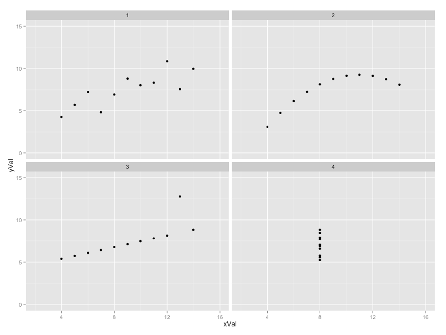
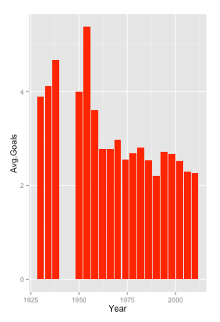

<h2>Last Week, You Said...</h2>

> [CHECK: week 6 exit ticket 1]

> [CHECK: week 6 exit ticket 2]

> [CHECK: week 6 exit ticket 3]

::: {.notes}

[CHECK] The week 6 export (stem: "A missing value is / isn't 'nothing', because...") didn't exist when this deck was drafted. Pick three that lead into today's question: something about who decides what a missing value means, and something about a number that looked clear but wasn't. Don't reuse tickets from an earlier session deck.

Say: these are anonymous, they get read, and three of them open each session. There's one at the end of today too.

:::

## Why these three?

- **[CHECK]:** one line linking each quote to today's material.
- **[CHECK]:**
- **[CHECK]:**

::: {.notes}

[CHECK] Write after choosing the quotes. Add one line on the learning half: what last week's tickets say about how the room is using the readings.

:::

## This Week's Question

<blockquote style="margin-top:150px">Can you prove anything with numbers?</blockquote>

&nbsp;

We'll answer it with code and readings, then with your draft answers to Question 1.

. . .

> "[...] we all want to be fair to our students". ~ @Bunday:0000 [p.3]

::: {.notes}

Three levels, one question. In code, the same data and a different line give a different answer. In the readings, one set of marks gives three different top students depending on how you total them. In your briefing, "is Airbnb out of control?" depends on what you decide to count.

Run sheet again, for the room: predict the output, readings, then a group's draft answer, and then where the numbers come from.

:::

# Predict the Output

Pairs. No laptops. Vote with your fingers.

::: {.notes}

Pairs means *whoever is sitting next to you*. 30 seconds to agree, then fingers up together. Reveal, then ≤ 60 seconds on the story. Tell video stories as "In the video, Jon...".

:::

## 1. Is It a Pandas Thing? {.smaller}

```python
import pandas as pd
import geopandas as gpd

# world is a GeoDataFrame
print(isinstance(world, str))
print(isinstance(world, pd.DataFrame))
print(isinstance(world, gpd.GeoDataFrame))
```

What does it print?

1. `False`, `False`, `False`
2. `False`, `True`, `False`
3. `False`, `True`, `True`
4. `True`, `True`, `True`

. . .

**Answer: 3.** `False`, `True`, `True`.

::: {.notes}

The expected wrong answer is 2: people think a `GeoDataFrame` has stopped being a `DataFrame`. Count hands.

Say: a `GeoDataFrame` *is* a `DataFrame` that has learned about maps, so you can use it anywhere you'd use one. That's inheritance, and it's why `.describe()` and `.groupby()` work on spatial data. Whoever built the class decided what counted as the same thing.

:::

## 2. Did the Original Change? {.smaller}

```python
# world is in EPSG:4326
world2 = world.to_crs('ESRI:54030')
print(world.crs)
print(world2.crs)
```

What does it print?

1. `EPSG:4326`, then `EPSG:4326`
2. `ESRI:54030`, then `ESRI:54030`
3. `ESRI:54030`, then `EPSG:4326`
4. `EPSG:4326`, then `ESRI:54030`

. . .

**Answer: 4.** `EPSG:4326`, then `ESRI:54030`.

::: {.notes}

The expected wrong answer is 2 (people expect the method to change the data in place). Count hands.

Say: `to_crs` returns a *copy*, as pandas methods do. Reprojecting is a transformation, and the original stays as it was: that's why you can show someone both and ask which one they'd trust.

:::

## 3. How Much Is 250? {.smaller}

```python
from shapely.geometry import Point

# a circle of radius 10 degrees, in EPSG:4326 (lat/long)
circle = Point(0, 0).buffer(10)
world = gpd.GeoSeries([circle], crs='EPSG:4326')
print(world.simplify(250).iloc[0].geom_type)
print(len(world.simplify(250).iloc[0].exterior.coords))
```

The circle has 65 coordinates. What does it print?

1. `Polygon`, then 65
2. `Polygon`, then about 30
3. `Polygon`, then 4
4. `Polygon`, then 0

. . .

**Answer: 3.** `Polygon`, then `4`: a triangle.

::: {.notes}

The expected wrong answer is 2 or 1 (people think 250 is metres). Count hands.

Say: `simplify` works in the units of the coordinate reference system. Here those are degrees, so 250 degrees is far bigger than the whole circle and the shape collapses to a triangle. The code ran without an error and the answer was wrong. Nothing in the output tells you.

:::

## 4. Same Summary, Same Data? {.smaller}

```python
# Anscombe's quartet: four data sets, each with 11 points
for x, y in [(x1, y1), (x2, y2), (x3, y3), (x4, y4)]:
    print(round(np.mean(y), 2), round(np.corrcoef(x, y)[0, 1], 3))
```

How many of the four lines print `7.5 0.816` (or `0.817`)?

1. 1
2. 2
3. 3
4. 4

. . .

**Answer: 4.** All four have the same mean and correlation.

. . .

{fig-alt="Anscombe's quartet: four scatter plots with identical summary statistics but very different patterns"}

::: {.notes}

The expected wrong answer is 1 or 2 (people don't believe it). Count hands.

Say: the four data sets have the same mean, the same correlation and the same fitted line, and they look nothing alike. If you only look at the summary you'll think they're the same. Start with a chart.

:::

# Can You Prove Anything with Numbers?

## Vote

According to the reading you did, you can prove anything with numbers if...

&nbsp;

1. **You choose the transformation:** the data are the data, and the method decides the answer.
2. **You ignore the process:** a number only means something if you know how it was made.
3. **Nobody checks:** it works until someone asks how the numbers were produced.

::: {.notes}

First, hands: who read Bunday? Lu & Henning? Arribas-Bel? More than one? None?

Then fingers, **by reading**: Bunday readers first, then Lu & Henning, then Arribas-Bel.

Then **1 minute of silent writing** ("my vote, and one passage"), *then* 4 minutes with neighbours: compare votes and find *one passage* that proves yours. Anyone who didn't read is briefed by a neighbour.

Plenary (15 min): walk the room and **ask pairs, not individuals** ("What did you two decide?"). Ask which reading only *after* they've answered. Start with Bunday, because it's a story and the shorter read (3 pages). End on Lu & Henning's "how wrong it is" and Arribas-Bel: a model is never right, and data that were never designed for your question are the hardest case, so the question is whether you know how they were generated.

If position 1 wins, push: in Bunday, every one of the three sheets is a defensible way of totalling marks. Who decided which was fair?

If position 3 wins, push: in Lu & Henning the process is only visible if someone asks where the salaries come from.

Reading load is about 15 pages in all: Bunday 3, Lu & Henning pp.67–69 only, Arribas-Bel 9. Lu & Henning is a paper written for statistics teachers, and it's easy to read it as being about teaching. Say that the same argument is about your briefing: where did these numbers come from?

:::

## Bunday (n.d.)

> Just what constituted a natural break had never been precisely defined but they all felt that they recognised one when they saw it. ~ @Bunday:0000 [p.1]

::: {.notes}

Reading notes: [CHECK] There are no annotations or summary for this reading. Add your margin notes here.

The story is a faculty meeting with twelve students and eight papers. The staff total the raw marks and a ranking appears. Someone suggests scaling each paper to 0–100 "to make the marks more comparable" and the ranking changes (the student at the bottom of the first list is at the top of the second). Someone suggests ranks instead, and the third sheet is a tie.

The quote is the first one in the paper. A "natural break" is what the classification chapter calls it: the same phrase is in the map classification video.

:::

. . .

> Since the marks seem to lead us into confusion perhaps we should consider the rankings in each paper. ~ @Bunday:0000 [p.3]

::: {.notes}

[CHECK] The text layer of the PDF is from a scan. Check both quotes against the scan: in particular "we should" (the layer has "wc~should").

Reading notes: nobody asks what the marks measure. Each change is made to "be fair". Say that this is the question for the group briefing: every step is defensible and the conclusion has moved.

:::

## Lu & Henning (2013)

> A statistical population only exists in the theoretical world. ~ @lu:2013 [p.67]

::: {.notes}

Reading notes: [CHECK] There are no annotations or summary for this reading. Add your margin notes here.

The paper is a teaching paper. The authors argue that a "population" is a mathematical idea, and that what we actually have is a *data-generating process*. The page that sets this out is p.67 with Figure 1: the real world on the left, the theoretical world on the right, and the data-generating process as the bridge.

:::

. . .

> It is never a matter of if the model is wrong (it is, as George Box assures us), but how wrong it is. ~ @lu:2013 [p.68]

::: {.notes}

Reading notes: pp.67–69 only: Figure 1, the problem with "population", and the retail cashier example. A Normal distribution allows negative salaries, so "salaries are Normal" is false. The authors' fix is to say "salaries are *modelled* using a normal distribution". The change is, in their words, "minor semantically but profound conceptually" (p.68).

Link to the practical: when you plot a distribution this week, you are choosing a model of how the data were made. The same sentence applies to a map classification.

:::

## Arribas-Bel (2014)

> [CHECK: verbatim quote and printed page from @arribas2014accidental]

::: {.notes}

[CHECK] The PDF isn't in the Week 7 readings folder yet, so there is no quote. Add the PDF, annotate it, and choose one passage on what "accidental" means.

Reading notes: the title is the claim: new data sources are "accidental, open and everywhere". Accidental data are a by-product of something else (a booking, a card tap, a call) and were not designed to answer a research question, so the process that made them is not the process you want to study.

Link to Question 1: Inside Airbnb is a collection of what hosts and guests wrote and did for other reasons. Ask what it can and can't show about "out of control".

:::

# What Does the Number Depend On?

## Three Sheets, Three Winners

| Total | Top | Bottom |
|---|---|---|
| Raw marks | Condon | Jolley |
| Scaled to 0–100 | Jolley | Condon (near the bottom) |
| Ranks | everyone, 52 | |

. . .

Is any of these *wrong*?

::: {.notes}

[CHECK] Check the table against the scan. The raw totals (Condon 448 first, Jolley 357 last) and the rank totals (every student 52) are as printed in the paper. The scaled sheet isn't printed in the text layer I could read: the paper says that scaling brought about the "miracle rescue of Jolley". Check the scaled order before you say it aloud.

Then: the three sheets are three ways of answering "how good is this student?", and nothing in the numbers tells you which to use. Compare with the map video: the same data in six classifications gave six different maps ("six views of employment"), and "there is simply judgment".

Ask pairs (1 minute of silent writing first): "Which would you have used, and who decides?"

:::

## Total or Average?

{fig-alt="Chart of the average goals scored per World Cup final"}

::: {.notes}

The total goals at a World Cup went up; the goals per game went down, because the number of games went up (the tournament went from 16 to 24 teams in 1982 and from 24 to 32 in 1998).

Say: same data, a different denominator, the opposite story. Nobody made a mistake.

Ask pairs: "If I told you Airbnb listings in London had doubled, what would you want to know before you believed it?"

:::

## What Would 'Out of Control' Mean?

You're asked: **Is Airbnb 'out of control' in London?**

| You could count | You'd be assuming |
|---|---|
| Listings | every listing is a home taken off the market |
| Listings per 1,000 homes | the number of homes is the right baseline |
| Nights booked | that reviews are a proxy for bookings |
| Hosts with many listings | that they are "professional" |

. . .

Which one goes on slide 1 of your briefing? **Who decides?**

::: {.notes}

1 minute of silent writing, then 2 minutes with neighbours. Ask two pairs, not individuals.

This is the bridge to the group slot after the break. Don't answer the question here: say that you'll hear one group's draft, and that each choice on the board is a transformation in Bunday's sense.

:::

## Draft Answers

- Your draft answer to **Question 1** is due this week; **Question 2** (professional landlords) is due next week.
- A group is selected at random to present its draft after the break. Formative feedback is given in class. If the group has not prepared an answer, there is no feedback.
- See [The Assessments](./5.5-Assessments.qmd) for how this works.

::: {.notes}

[CHECK] There is no `Week 7 Session.md`, so this admin is drafted from `5.5-Assessments` and `assessments/_questions.qmd` (Question 1: draft due Week 7; Question 2: Week 8). Confirm the dates and whether the group sign-up is closed.

Keep this short.

:::

## Intro to the practical

Here's what we're covering:

- Creating and working with geo-data in Python.
- Making maps with GeoPandas.
- Exploring the data visually: distributions, outliers, and spatial patterns.
- Using the Inside Airbnb data's second 'class' of information: *where* it is.

::: {.notes}

[CHECK] There is no `Week 7 Session.md`, so these bullets are drafted from the session page's "Connections" box. Replace them with your own.

Then the break (7 min). After the break: the group slot, then the talk on where numbers come from.

:::

# Group Slot

## Is Airbnb 'Out of Control' in London?

One group presents its draft answer. **Five minutes.**

When you listen, ask:

- What did they count, and what are they assuming?
- Where did the numbers come from? Who made them?
- What would change their answer?

::: {.notes}

Select the group at random in front of the room (a number from a list: not a person). If the group has no draft, say so and move on: there is no feedback, as the assessments page says.

5 minutes for the group. Then 1 minute of silent writing for the room, 2 minutes with neighbours, then ask **pairs** for feedback. Last, give your own: choose one thing they counted and ask what they'd need to know to believe it.

Starting points for feedback if the group needs one (from 2025): a published heuristic is better than a guess (estimate nights from reviews with a review rate and an average stay, then compare with the 90-day limit); read Airbnb's own methodology; think about density *relative to* something (homes, population) rather than raw counts. [CHECK] Don't present these as the answer.

If the group runs over, stop at 5 minutes. Remind the room that the question is a draft: the point is the thinking.

:::

# Where Did This Number Come From?

## The Data Looked Complete

The Land Registry and the Energy Performance Certificate records promise *every property sold in the UK since 1995*.

. . .

But certain kinds of record are excluded, and some people entered their data incorrectly, **sometimes deliberately**.

::: {.notes}

Say: this is the "are the data appropriate to the question?" step in the epicycles of analysis. You only find the weaknesses by engaging with the data.

Ask neighbours (1 minute of silent writing first): "What would you ask about the Airbnb data in the same way?" Two pairs.

:::

## Crime Figures Count Reports

Raw crime rates are used to find hotspots. But:

- not every victim reports a crime, and the ones who do aren't a random sample;
- pickpocketing and assault are both "crime";
- the rate depends on whether you count residents or the people who are there;
- the law and policing differ between places and months.

. . .

**Is Kensington and Chelsea more dangerous than Peckham?**

::: {.notes}

Say: the data-generating process is not the crime. It's the report, the police's decision to record it, and the law. Whoever built the data decided what counts.

Ask pairs (1 minute of silent writing first): "More dangerous for whom?" Two pairs.

:::

## When Reports Go Up

> [CHECK: Clery Act / Emerson College, @dignazio:2020ch6]

::: {.notes}

[CHECK] Read @dignazio:2020ch6 pp.10–13 before using this slide. From the To_Do note: colleges with higher *reported* assault rates were often the ones putting more resources into supporting survivors, and colleges have a financial incentive not to report. A safer-looking campus may be one that is counting less.

Margin note to give: this is why geospatial analyses of crime data are nearly always problematic. Replace the placeholder above with a verbatim quote and printed page number.

:::

## When Searches Are the Signal

> [CHECK: Google Flu Trends, @dignazio:2020ch6]

::: {.notes}

[CHECK] Read @dignazio:2020ch6 p.14 before using this slide. From the To_Do note: searches are not a one-to-one signal for flu cases, because they respond to what the media reports. The "data-generating process" in Lu & Henning's sense: the people searching, and what they had just read.

Replace the placeholder above with a verbatim quote and printed page number.

:::

## Who Is Missing?

During the Second World War, the returning planes were covered in bullet holes. The holes were where a plane could be hit *and still return*.

. . .

Where would you reinforce them?

::: {.notes}

[CHECK] This came from a student in 2025 (the transcript doesn't give the details). Check the story before you tell it. The usual version is Abraham Wald's survivorship-bias argument: reinforce where there are *no* holes, because planes hit there didn't come back.

1 minute of silent writing, then 2 minutes with neighbours. Ask two pairs.

Link: Bunday's staff never asked who wasn't in the data. Lu & Henning's process view asks how a plane gets *into* the sample. For Airbnb: who isn't in the listings?

:::

## So, Can You Prove Anything with Numbers?

1. The numbers are the *output* of a process.
2. Each choice (what to count, how to scale, where to cut) moves the answer.
3. Say what you chose and why.

::: {.notes}

Ask neighbours (1 minute of silent writing first): "What will you write in your briefing about where your numbers came from?" Two pairs, not individuals.

If time is short, drop "When Searches Are the Signal".

:::

# Over to You

## Before You Go...

Complete the sentence:

&nbsp;

You **can / can't** prove anything with numbers, because...

&nbsp;

A selection will open next week's session.

## Input

Provide your input here: [form.menti.com/s/alb33vmjf1ow](https://form.menti.com/s/alb33vmjf1ow)

{height="500px"}

::: {.notes}

Mentimeter (open text) in a second browser tab. Start at minute 110 sharp, leave the code on screen, and give 3 minutes of silence before saying anything else. Say that it's anonymous, and that today opened with three of last week's.

:::

# Thank You {background-image="/img/web/title-slide.png" background-color="#f7eff5" background-opacity="0.2"}

<h3>References</h3>
